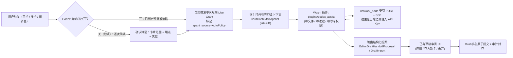
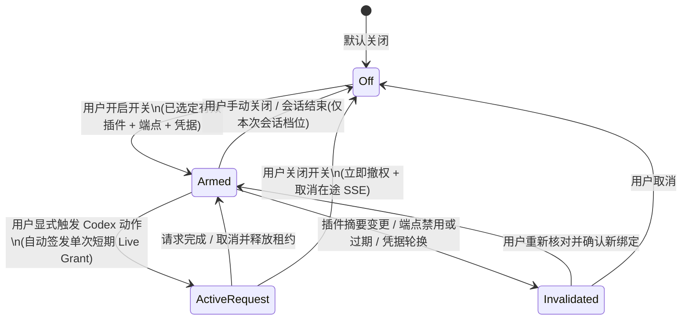

# 提案：0.2.0 Codex 辅助改走路线一（受管 HTTP/SSE + 草稿提案），原生沙箱冻结至 0.3.x，并新增受控「自动获权」切换开关

- **署名**：Gemini
- **日期**：2026-11-24
- **状态**：提案草案（供主 Agent 复盘与合并；纯文档提案，不改动任何现有源码）
- **关联规划**：[架构基线](ARCHITECTURE_BASELINE.md) · [未来路线](FUTURE_ROADMAP.md) · [执行路线修订](ROADMAP_UPDATE_2026-09-15.md) · `docs/UI_LAYOUT_PLUGIN_PROPOSAL.md`（见 PR 分支 `docs/ui-layout-plugin-proposal`）

---

## 1. 提案结论与背景

当前 `0.1.9-test.58` 预构建与 `0.2.0` 推进过程中，Rust 侧复杂度与门禁压力剧增的根本原因在于：**为了在 `0.2.0` 前接入 Codex 辅助，主仓直接内嵌了 `companions/morrow-codex`（约 4.4 万文件）并由 Morrow 宿主自行承担 Windows OS 级原生进程沙箱（`LogonUserW`、`CreateRestrictedToken`、DACL、WindowStation 与 47 步 VM 验收）**。

为在不放弃 **“0.2.0 具备 Codex 辅助”** 产品目标的前提下立刻降载、盘活既有工作成果，本提案建议：

1. **0.2.0 主线切回「路线 1：卡片级 Codex 辅助」**：以标准受限 Wasm 插件（`plugins/codex_assist`）复用现已建成的**凭据/端点审批 + 受管 HTTP/POST SSE + 草稿提案审阅**基础设施，零原生进程、零文件系统权限、全平台同构。
2. **「路线 3：内嵌原生 OS 沙箱 / Agent 执行域」冻结至 0.3.x**：保留已有源码与验证记录在冻结基线中，通过默认关闭的 Cargo feature 移出 `0.2.0` 默认构建与门禁。
3. **新增受控「允许 Codex 自动获权」切换开关**：兼顾连续使用体验与 Morrow“持久策略不等于活权限”的安全审计原则。

---

## 2. 路线 1 整体数据流与控制流

核心隔离保证：**Codex Wasm 插件全程不接触本地磁盘、不启动操作系统进程、不读取 API Key 明文，也不拥有直接修改正式内容库的权限。**

---

## 3. 现有资产精确盘点与切分

### 3.1 零改动 / 直接复用的已完成项

| 能力域 | 已有 Rust / Schema 资产 | 已有 Dart 客户端与 UI 资产 | 在路线 1 中的职责 |
| --- | --- | --- | --- |
| **凭据与端点审批** | `core/schemas/outbound_authority.proto`、`tls_identity.proto`、`io_manifest.proto` | `lib/plugins/credential_manager.dart`、`endpoint_manager.dart`、`endpoint_control.dart`（`EndpointPolicy` / `StoredEndpoint`） | 管理 API 端点、TLS 身份与 Key；凭据明文由宿主在出站边界注入 |
| **受管 HTTP + POST SSE** | `network_node`（`plugin-adapter`）、`core/schemas/io.capnp`、`channel.capnp`、`io_intent.proto` | `lib/plugins/http_task_manager.dart`、`channel_task_manager.dart`、`channel_task_session.dart` | 承载模型流式响应，自带字节预算、超时、并发上限与取消控制 |
| **草稿提案与审阅落盘** | `plugins/workbench/schemas/editor_draft_api.capnp`、`editor_draft_staging_api.capnp`、`core/schemas/record_transaction.proto` | `lib/plugins/editor_draft_handoff_coordinator.dart`、`editor_draft_handoff_proposal_native.dart`、`editor_draft_import*.dart`、`editor_draft_review*.dart`、`editor_commit_proof*.dart` | 将模型产出落为可审阅、可丢弃、可崩溃恢复的待确认提案并原子提交 |
| **Wasm 运行时与内容投影** | `core`、`plugin_runtime`、`plugins/workbench`、`audit` | `lib/plugins/plugin_library.dart`、`versioned_content*.dart`、`query_coordinator.dart` | 安装/启停插件、提供版本化卡片只读视图与审计封存 |

### 3.2 需要微创修正的已有接口（仅 4 处）

1. **Rust 默认依赖瘦身（`workbench_host/Cargo.toml`）**
   - 将 `morrow-codex-session-exec-windows-v1`、`morrow-agent-*`、`morrow-native-pipe-win` 移入默认关闭的 Cargo feature（如 `experimental-native-agent = []`），移除默认构建对 `companions/morrow-codex` 与针对 openai fork 的 `[patch.crates-io]` 的强绑定。
   - **协议号兼容**：已存在的 `agent_session` / `agent_wrapper` Cap'n Proto ID 不删号；未开启该 feature 时统一返回结构化错误 `Unsupported("native-agent-deferred-to-0.3")`。
2. **有界只读卡片上下文快照（复用 `versioned_content`）**
   - 宿主按用户当前选中范围构建 `CardContextSnapshot`（卡片引用 ID、标题、正文 Markdown、类别/阶段、待办完成态、可选纯文本附件摘要），硬预算上限 ≤ `64 KiB`（UTF-8 边界安全截断）。
   - **禁止插件自行全库检索或遍历未选中卡片**。
3. **只读推理端点的 SSE 终态语义放宽**
   - 在 `io_intent` / `channel` 路由上为纯生成类模型请求标记 `read_only_remote_inference` 语义：中途取消或断连时立即释放流租约并允许重试，不阻塞在 `Unknown` 副作用恢复锁中（真正的状态写入发生在下游用户审阅提交阶段）。
4. **草稿提案来源标识泛化（复用 `EditorDraftHandoffProposal` / `EditorDraftImport`）**
   - 为提案载荷补充 `origin = PluginProposal { packageId, packageDigest, operationId }`，在审阅界面明确提示用户“此建议由 Codex 插件生成”，防止与本地编辑器自动恢复草稿混淆。

### 3.3 冻结至 `0.3.x` 的路线 3 资产（保留源码，移出 `0.2.0` 默认编译与门禁）

- **Rust**：`companions/morrow-codex/*`、`native_pipe_win_001`、`native_session*`、`windows_user_directories`、`extensions/agent-session-*`、`agent-process-control-*`、`agent-catalog-*`。
- **Dart**：`lib/plugins/agent_session_*.dart`、`agent_wrapper_*.dart`、`agent_task_discovery.dart`、`qualification_session_*.dart`、`workbench_supervision*.dart`（原生 runner 监管分支）。
- **可顺带降级为 `0.2.x` 非阻塞实验项**：`fs_watch_*`、`directory_task_*`、`blob_upload_*`、`guest_mutation_*`、`service_run_*`（入站服务节点）。

---

## 4. 「允许 Codex 自动获权」切换开关详细设计

依据 `lib/plugins/endpoint_control.dart` 既有契约：

> *Persisted policy metadata; saving it never creates an active network grant.*

本开关**绝非“持久保存一张永久万能通行证”**，而是**严格受约束的“会话级自动签发闸门（Scoped Auto-Grant Gate）”**。

### 4.1 开关分层与作用域
- **主开关**：`允许 Codex 自动获权`（**默认关闭**）
  - **关闭（默认严格模式）**：每次调用 Codex 必须弹窗确认卡片范围、目标端点与凭据；结果进入提案待审阅。
  - **开启（自动获权模式）**：用户显式触发 Codex 辅助动作时，宿主跳过重复弹窗，自动签发**单次、有界、短期**的运行期 `live grant`（仅限预绑定端点与当前聚焦卡片只读上下文）。
- **作用域子选项（主开关开启后可配）**：
  1. **有效期档位**：`仅本次应用会话`（默认，重启后自动复位关闭） / `7 天内有效` / `直到手动关闭`；
  2. **上下文边界**：强制锁定为 `仅当前打开/选中的卡片`（不可放开全库自动扫描）；可选 `携带当前卡纯文本附件摘要`（默认关）；
  3. **结果落点（不可关闭的硬底线）**：即使开启自动获权，模型结果**永远只进入待审阅草稿/提案**，绝不静默覆写或删除已提交卡片。

### 4.2 必须锁死的 5 条安全与审计红线

1. **强身份与摘要绑定（防调包）**：策略必须绑定具体 `packageId` + `packageDigest`（SHA-256）+ `StoredEndpoint.reference` + `StoredEndpoint.revision` + `credentialReference`。**插件升级/重装（摘要变化）、端点修改或禁用、凭据轮换或删除、端点过期，任一条件触发均立即置为 `Invalidated` 并退回人工确认。**
2. **持久化只存偏好，不存 Live Grant**：本地存储（Protobuf+LZ4）仅记录偏好绑定元数据；每次启动必须经 `Registry` + `EndpointControl` 重验全部条件通过后才可激活。
3. **只放行用户显式交互触发**：仅免除“确认弹窗”，必须在用户明确点击 Codex 动作或发送指令时签发单次请求；**禁止插件通过后台定时器或空转轮询静默发起联网请求**。
4. **复用 `EndpointPolicy` 硬限额**：受限于端点的 `maxRequestBytes`、`maxResponseBytes`、`maxConcurrent`（建议默认 `1`–`2`）、`timeoutMs` 与会话级防连点速率上限。
5. **一键熔断 + 独立审计标记**：关闭开关立即遵循“先撤权、再取消”原则中止在途 SSE 作业；所有经由该开关签发的请求必须在 `io_intent` 与 `audit` 事件中显式标记 `grant_source = AutoPolicy { policy_revision, endpoint_ref, package_digest }`，与 `ManualConfirm` 严格区分。

### 4.3 开关状态机与工作台防误触提示

- **设置页呈现（`io_settings_page` / 插件设置）**：清晰展示已绑定的端点域名、凭据名、插件摘要短码、有效期，以及不可关闭的保护提示（“开启后免去每次联网确认弹窗，但生成内容仍需审阅后才会写入卡片”）。
- **工作台常驻防误触徽章**：开启期间在顶部命令栏或检查器角落显示轻量徽章（如 `Codex · 自动`），点击可**一键关闭（立即熔断）**或跳转核对绑定详情。

---

## 5. 新增官方轻量 Wasm 插件规格：`plugins/codex_assist`

与 `plugins/mid_autumn`、`plugins/http_forward` 同级，采用纯 Rust 编译为 `wasm32-unknown-unknown`：

- **支持 Handler**：
  - `codex.assist.rewrite`（润色/改写当前卡片 → 单卡 `DraftProposal`）
  - `codex.assist.breakdown`（将灵感拆解为项目步骤/待办 → 带 `todos` 的 `DraftProposal`）
  - `codex.assist.summarize`（汇总选中卡片或实验记录 → 新建卡 `DraftImport`）
- **权限声明**：仅申请 `http/sse` 出站能力（目标 `origin` 由用户在宿主端配置），**零文件、零目录、零本地进程权限**。
- **故障退化**：网络断连、超时或输出非预期格式时，保留已接收的流式纯文本在临时预览区供用户复制，不污染任何正式数据。

---

## 6. `0.2.0` 精简收口验收清单与 `0.3.x` 衔接点

### 6.1 `0.2.0` 核心验收闭环（取代重型 47 步原生 VM 门禁）
1. **内容与迁移**：旧库迁移校验、版本化编辑、草稿自动保存与重启恢复通过。
2. **Wasm 插件基础**：`workbench` 与 `mid_autumn` 主题插件正常启停与卸载无损回退。
3. **受管出站 HTTP/SSE**：真实 HTTPS POST + SSE 正常流式接收、主动取消、断连退化与凭据边界注入通过。
4. **Codex 路线 1 闭环**：选中卡片 → `plugins/codex_assist` 调模型 → 生成 `DraftProposal` → 用户审阅提交 → 审计封存与独立核验通过。
5. **自动获权开关矩阵**：
   - 默认关闭必弹窗；
   - 开启后免弹窗且审计精确记为 `AutoPolicy`；
   - 插件摘要变更 / 端点禁用 / 凭据轮换后自动跳转 `Invalidated`；
   - 请求中途关闭开关立即撤权并中止 SSE；
   - 任何模式下均不静默覆盖正式卡片。
6. **路线 3 冻结验证**：默认构建脱离 `companions/morrow-codex` 与原生沙箱依赖；旧 `agent_session` 调用返回明确 `Unsupported`。
7. **桌面渲染与无障碍**：合入 `shaders/liquid_glass.frag` Y 轴适配与 `AXTree` 稳定修复。

### 6.2 面向 `0.3.x`（路线 3 解冻）的平滑衔接
- **能力位渐进扩展**：`0.2.0` 的 `CodexAutoGrantPolicy` 仅覆盖 `outbound_http_sse` + `selected_cards_readonly`；待 `0.3.x` 完成原生沙箱验收后，在同一策略框架下新增更高等级能力位（如 `scoped_directory_read`、`sandboxed_runner`），且**高等级能力默认强制逐次人工确认，不继承 `0.2.0` 已开启的自动获权**。
- **回写通道统一**：`0.2.0` 与 `0.3.x` 的所有外部代理产出共用同一条 `DraftProposal / DraftImport → 用户审阅 → 核心原子提交` 通道。

---

## 7. 供主 Agent 复盘与合并的评审清单

- [ ] 确认将 `0.2.0` 的 Codex 接入范围正式锁定为 **路线 1（`plugins/codex_assist` + 受管 HTTP/SSE + 草稿提案）**，将 **路线 3（`companions/morrow-codex` + 原生沙箱 / VM 47 步）** 冻结至 `0.3.x`。
- [ ] 确认在 `workbench_host/Cargo.toml` 使用默认关闭的 Cargo feature 隔离原生 Agent 依赖，保留 Cap'n Proto 协议号并返回 `Unsupported`。
- [ ] 评审第 4 节「允许 Codex 自动获权」开关的 5 条红线（强摘要/修订绑定、仅偏好持久化、仅人工触发放行、先撤权再取消、独立 `AutoPolicy` 审计标记）。
- [ ] 评审该方案与另一份纯文档提案 `docs/UI_LAYOUT_PLUGIN_PROPOSAL.md` 在 `0.2.0` → `0.3.x` 主规划线上的协同排序。

---

*提案撰写与归档：Gemini*
