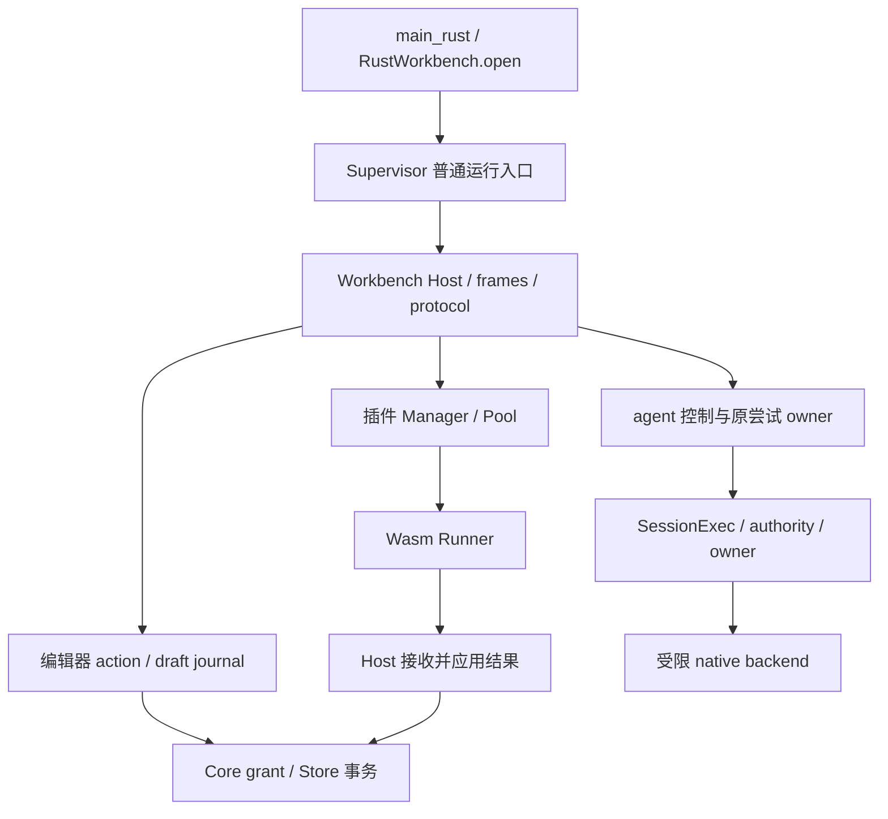
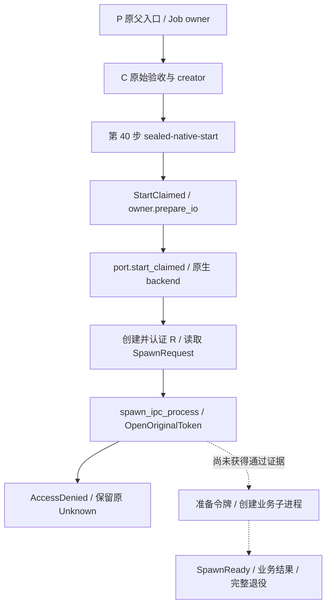
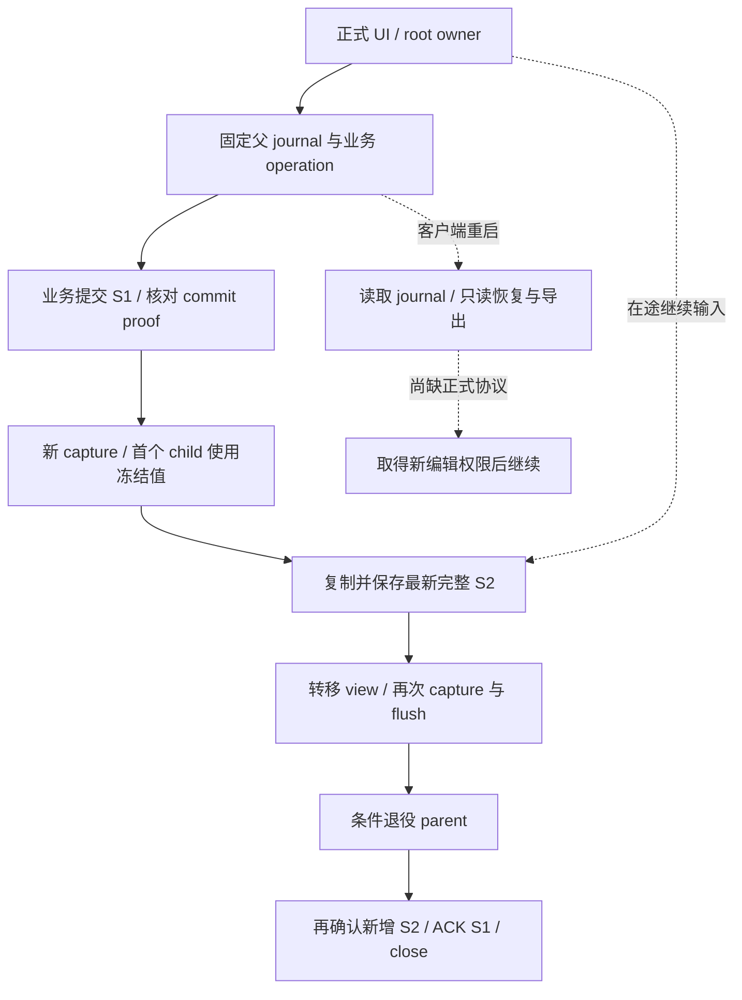
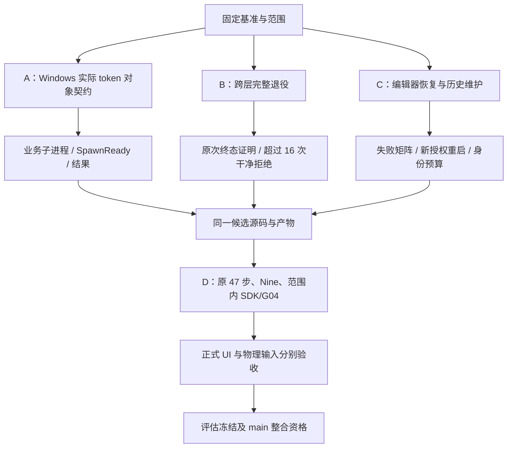

# Morrow 当前卡点与调用链分析

> 本文归档 2026-10-21 已完成的只读源码分析，结论固定于 `codex/local-continue-20261020@f8ef33ec091a82d68f3c2745dde950f8762d8878`。本次文档归档没有新增产品验收，不更新既有资格状态，也不意味着后续分支提交自动获得本报告描述的运行证据。

- **可视化网页：** [morrow-blockers-callchains.html](./morrow-blockers-callchains.html)
- **固定源码：** [f8ef33ec091a82d68f3c2745dde950f8762d8878](https://github.com/StarrySky7D4/morrow/commit/f8ef33ec091a82d68f3c2745dde950f8762d8878)
- **该源码提交时间：** 2026-10-21 19:45:24（北京时间）。
- **资格状态：** `source_accepted=false`、`release_eligible=false`，属于验收暂停的开发快照。
- **分析方法：** 固定提交的静态调用链追踪、源码边界核对、仓库现有验收记录复核。没有为本报告运行 Windows fixture、CI 或故障注入。
- **证据限制：** 部分源绑定日志和原始回执仍位于原 Windows 工作机；本次未独立取得或复现全部原始材料。下文将源码事实、仓库运行记录和条件性推导分别表达。

## 1. 当前结论与三条收尾主线

当前最靠前的受限 Windows 执行阻塞，已经定位到 **R 进程内打开自身主令牌**：

```text
OpenProcessToken(GetCurrentProcess(), TOKEN_QUERY | TOKEN_DUPLICATE, ...)
```

最新 case014 的原始第 40 步记录为 `SpawnChild / AccessDenied / OpenOriginalToken`。当前 target policy 已通过，R 已创建；业务子进程尚未获得启动成功证据。具体由哪条 DACL、MIC 或调用者上下文条件导致拒绝，仍为 `NOT_YET_OBSERVED`。[当前门禁][Q]、[最新 case 与 phase016][LATEST]

另外两条独立主线是：

1. **完整资源退役：** native、registry、SDK、factory、account/setup 之间仍缺少贯通的、可单次消费的干净拒绝证明。
2. **编辑器恢复：** 正式 owner、草稿持久化、S1→S2、只读重启恢复和显式退役已经接通，但失败阶段推进、重启后重新取得编辑权限及历史身份维护仍有缺口。

三条主线可以并行推进；最终产品资格必须绑定同一候选源码、协议与产物，不能用不同快照的局部成功拼成整体通过。

### 已过时的旧判断

- 原始 47 步驱动及八个输入已经恢复，`missing_acceptance_inputs=[]`；当前不再是缺验收输入。
- L0 已有指定快照的局部通过证据；L1 runner 仍未通过。
- 正式编辑器持久化与交接已实现，不能继续写成“尚未实现自动保存/S1→S2”。
- 本轮 Windows 优先；其他平台属于延期，既不能标为通过，也不应自动加入本轮 Windows 收尾的前置条件。[当前资格与范围][Q]

## 2. B1–B6 卡点台账

优先级针对本轮 Windows 与正式编辑器收尾：P0 阻断受限执行验收，P1 阻断可靠恢复或长期使用，P2 属于冻结与集成门禁。未运行的下游环节没有被写成已失败。

| 编号 | 优先级 | 当前事实与证据类型 | 关闭条件 |
| --- | --- | --- | --- |
| B1 | P0 | **运行记录：** R 打开自身实际主令牌被拒绝；拒绝子机制未证明。 | 对齐实际对象、调用者、访问掩码；贯通业务子进程启动与 `SpawnReady`，再验证业务结果和收尾。 |
| B2 | P1 | **部分实现：** 可证明干净拒绝尚未跨 native / registry / SDK / factory / account / setup 贯通。 | 原次清理证明只消费一次；正常 join/ACK/retirement 完整；连续超过 16 次确定干净拒绝不积累占用。 |
| B3 | P1 | **源码事实：** 跨客户端恢复只有只读查看和导出；没有重新取得编辑权限的正式链。 | 新 capture authority、当前源版本、唯一 successor、附件 pins 与历史来源证据共同绑定。 |
| B4 | P1 | **源码推导：** 退役前只读失败可冻结 owner；successor / ACK / close 等提交阶段缺少完整恢复推进分支。 | 区分未发送、已发送未知、持久结果已证明、资源终态已证明，逐阶段补齐观察与收尾入口。 |
| B5 | P1 | **源码事实：** 16 个活跃草稿槽与 256 个历史 journal 身份是不同预算；inactive 不等于身份回收。 | 有证据约束的历史维护策略，保留幂等回执、父子谱系、capture 归档及未决操作。 |
| B6 | P2 | **开放门禁：** SDK26/G04/FREEZE 未关闭，局部证据来自不同快照；开发线与 main 分叉。 | 明确命名 profile 和平台范围，在同一最终候选上验收，并核对 main 的等效修复与冲突。 |

对应证据见[当前门禁][Q]、[只读恢复边界][REVIEW]、[退役预检][RETIRE]、[提交恢复分支][COMMIT-RECOVER]、[身份容量检查][DRAFT-CAPACITY]。

## 3. 总调用链：普通工作区与受限执行入口

Windows 原生入口通过独立 host 进程执行。Flutter 与 host 之间交换有长度边界的控制帧，host 再按 action 或专用 magic 分派。普通工作区启动与显式选入的 Source047 验收共享部分二进制和底层组件，但入口、所有权与验收要求不同。



图中表示模块关系及调用方向；已有源码路径不等于整个固定提交已通过运行验收。

| 层 | 实际函数链与边界 |
| --- | --- |
| 应用启动 | `main_rust → RustWorkbench.open → Process.start`；Windows 启动 supervisor，首次 `pageVersioned` RPC 后继续初始化。 |
| 双入口 | `run_asuser_parent` 在普通 `run_supervisor` 之前分派；应按实际入口解释故障影响。 |
| 控制通道 | `_callDecoded → _businessQueue → _exchangeDecoded → _queue`；scheduler 有独立业务路由，底层帧仍串行。 |
| Host 路由 | `frames → protocol::respond`；agent discovery/control 等使用专用 magic，普通 host action 进入 `ResponseTarget`。 |
| 插件路径 | `Manager.activation_plan → Pool.start/run_task → ManagedInstance / Runner`；检查包版本、批准、实例和生命周期。纯转换任务与直接 journal 写入是不同路径。 |
| 草稿存储 | `editor_draft_api::handle → save_editor_draft_linked → write_draft_journal → Core grant / Store`。 |

源码：[原生启动][OPEN]、[supervisor 双入口][SUPERVISOR]、[RPC 队列][RPC]、[host 帧处理][FRAMES]、[插件 Pool][POOL]、[journal 写入][JOURNAL]。

**B1 的影响必须限定为当前受限 Windows 执行器的端到端链。** case014 失败不能直接推出普通工作区或所有 Wasm 插件不可用；普通 UI 能打开也不能证明受限执行器已可用。

## 4. 主线一：Windows 令牌对象与真实启动链

### 4.1 P/C/R/S 的角色

| 角色 | 产物与职责 |
| --- | --- |
| P | `morrow-workbench-supervisor.exe` 的 Source047 原父入口，保留原 Job owner。 |
| C | `morrow-protected-checked-vm-harness.exe`，承载原始验收与 creator 执行路径。 |
| R | `codex-command-runner.exe`，认证请求后准备并启动业务子进程。 |
| S | `codex-windows-sandbox-setup.exe`，有界 setup helper，包含固定 C/R allow-table；S 不是业务子进程。 |

角色名称映射见[四角色构建记录][ROLES]。该旧记录只用于角色映射，不替代当前二进制验收。



`AgentCommand::StartClaimed` 先执行 `owner.prepare_io()` 和控制检查，再进入 `port.start_claimed()`。原生 backend 经 `spawn_asuser_runner_transport()` 创建并认证 R。结合仓库认证失败记录与源码控制流，R 已执行到读取 `SpawnRequest` 后的 `spawn_ipc_process()`，并在打开原始令牌时失败。`SpawnReady` 位于业务子进程启动之后，不能把“R 已创建”当作 ready。[worker][START] → [port][PORT] → [C 启动与认证][RUNNER] → [R 子进程准备][SPAWN] → [失败 API][TOKEN]

### 4.2 检查对象、调用者与访问掩码尚未完全对齐

| 对象或操作 | 已检查内容 | 仍不能证明什么 |
| --- | --- | --- |
| 创建前 launch-token 对象 | `capture_token_security()` 用 `GetKernelObjectSecurity` 读取其对象 DACL 与 label。 | R 创建后的实际 primary-token 对象拥有相同安全描述符。 |
| `TokenDefaultDacl` | 精确默认模板，允许项当前为 `READ_CONTROL`，用于后续对象创建。 | 它就是 token 对象自身的 DACL，或可安全填入 token 专用访问位。 |
| C 创建 R 后 readback | 检查 R 的进程/线程安全描述符；以 `READ_CONTROL \| TOKEN_QUERY`（`0x20008`）打开 R token，读取 token facts 与 default DACL。 | 实际 R token-object 的 DACL/MIC 满足 R 自开要求；R 调用者拥有 `TOKEN_DUPLICATE` 权限。 |
| R 打开自身 token | 请求 `TOKEN_QUERY \| TOKEN_DUPLICATE`（`0xA`），目前被拒绝。 | C 能查询该 token，就等于 R 能以另一掩码打开它。 |

源码区分了[创建前与创建后检查][READBACK]以及[默认模板的对象语义][TOKEN-SECURITY]。Microsoft 文档说明 `OpenProcessToken` 的访问请求按 token 对象的 DACL 检查，而 `TokenDefaultDacl` 是新对象的默认 ACL 模板。[OpenProcessToken 官方文档](https://learn.microsoft.com/en-us/windows/win32/api/processthreadsapi/nf-processthreadsapi-openprocesstoken)、[TOKEN_DEFAULT_DACL 官方文档](https://learn.microsoft.com/en-us/windows/win32/api/winnt/ns-winnt-token_default_dacl)

**phase016 仅提供候选机制证据。** 独立探针观察到新进程实际 primary-token 对象 DACL 反映 launch `TokenDefaultDacl`，与创建前对象不同；实验性初始化后，仅证明父进程 query/duplicate 读取成功，受限子进程仍以 `0xC0000142` 在 main 报告前退出。它没有证明 case014 的实际因果，也没有证明产品 L1 已修复；新初始化方案尚未进入产品。该 fixture 的观察不能扩写成 Windows 对所有新 primary-token 对象来源的通用保证。[phase016 记录][LATEST]

### 4.3 推荐修复单位

在**新独立 case** 的既有 post-create readback 窗口，关联同次实际 R token-object 的 owner、DACL、MIC、原调用者上下文、请求掩码与认证失败；证明拒绝条件后，再设计类型专用的 token-access 契约与生命周期。保留精确 LogonSID 和最小权限，随后贯通业务子进程启动、`SpawnReady`、结果和收尾。

不宜直接扩大通用 `TokenDefaultDacl`：token QUERY 与线程 GET_CONTEXT 的位值存在重合，同一数值在不同对象上有不同语义。以上是后续实施建议，本次没有恢复已暂停的验收。

## 5. 主线二：完整资源退役与 16 的容量边界

正常清理已经有实际结构，其顺序是：

`业务完成/native ACK → formal worker join → 暂存原 runtime → protected owner finish/flush → scheduler shutdown → native threads 等待与 checked close → execution.retire_factory → 原次清理准入 → account/setup 收尾`。

最近修正使原 protected owner 能在 scheduler **实际 shutdown 之前**完成；这解决一个前置条件，却没有关闭完整 P2 干净拒绝路径。[正常收尾顺序][CLEANUP]、[factory 退役边界][FACTORY]

| 事实 | 准确含义 | 不能推出 |
| --- | --- | --- |
| `RunnerDispatch::Rejected` | 创建 API 明确拒绝且观察未丢失。 | 所有资源都已关闭。 |
| `LocalResources::Closed` | 本层已拥有的资源关闭。 | registry、SDK、factory、account/setup 全部完成退役。 |
| `policy_clean=true` | 原 owner 恢复临时权限配置，policy handles 有关闭记录。 | `case_clean=true`，或已签发令牌没有剩余义务。 |
| `Unknown / observation_lost` | 保留原 owner 与已知事实，不能由迟到结果自动改写历史结论。 | 可重放同一 case、换 operation 或删除 ledger 恢复容量。 |
| context `settle` | resources clean、authority retired、要求的 join 均成立后才移除 ledger 项。 | caller drop 等价于 settle；drop 实际只是 park。 |

原生 execution registry 与 agent context 各有 **16** 的边界。如果确定干净拒绝的证明不能跨层消费，安全保留策略可能形成可用性限制。当前能确认有界容量与未闭合契约，**没有本次实测证明“第 17 次必然失败”**。这个 16 与编辑器的 16 个活跃草稿槽是不同资源，不能混为同一配额。[结果维度][OUTCOME]、[park 与 settle][SETTLE]、[P2/P3 待办][OPEN-WORK]

整体修复应让同一尝试的 native、registry、SDK、factory、account/setup 事实贯通，最终只有一个消费出口归还额度。确定干净拒绝可以释放；Unknown 继续保留。验收应同时覆盖正常完成和连续超过 16 次确定干净拒绝，而非仅检查本层 token handle 已关闭。

## 6. 主线三：编辑器保存、交接、重启与长期维护

### 6.1 已实现的正式保存链

工作台持有 `EditorDraftOwner`，对话框只租借 view。五个原始文本值、选区、IME composing、元数据、附件与 capture 来源经 `EditorDraftBinding.capture → Session.observe → flush/_startSave → NativeEditorDraftControl.save` 保存；原生适配器以 `begin/append/finishEditorDraft` 分块传输，Host 核对外层身份和摘要，再经 Core 授权写入 journal。[输入采集][BINDING]、[分块保存][DRAFT-NATIVE]、[Host 请求绑定][DRAFT-API]、[journal][JOURNAL]

正式业务保存经 `NewIdeaDialog._saveOwned → beginEditorDraftCommit → CommitAttempt.start`：固定父草稿和业务 operation，提交 S1，核对真实 commit proof，打开新 capture authority，创建首个 child。**首个 child 使用冻结父草稿的值；提交期间继续输入的最新 S2 在 child 创建后通过 `_copyLatest()` 复制和持久化。** 随后转移 view，`finish()` 再次保存 S2，条件退役 parent，再次确认新增 S2，最后 ACK S1、关闭原 capture、恢复 successor 自动保存。[S1 与 successor][COMMIT]、[收尾顺序][COMMIT-FINISH]



此图的虚线表示条件分支；只有标注“尚缺正式协议”的恢复路径尚未闭合。S2 持久化、parent 退役、S1 ACK、capture close 是不同门槛。

### 6.2 B3：跨客户端恢复仍缺新授权

`EditorDraftReview` 不携带 live capture、replay grant、draft owner 或业务 ACK 权限。只有当前客户端内存中仍存在同一个 owner，`retainedEditorDraft()` 才能重新挂接编辑 view。客户端重启后已有 journal 发现、精确 generation/request 核对、附件 pins/capture archive 导出和只读 formal dialog；归档中的 scope 字符串不会复活旧权限。[只读投影][REVIEW]、[正式恢复 UI][RECOVERY-UI]

应补“核对当前源版本 → 建立新 capture authority → 绑定原持久证据和唯一 successor → 处理冲突/双活 → 继续编辑”的协议，不能靠反序列化旧 owner 绕过授权转换。

### 6.3 B4a：退役 preflight 只读失败可冻结尚未发送的尝试

以下是**静态推导，未运行故障注入**：

1. `EditorDraftRetirementAttempt._run()` 先同步 `_reserveOwner()`，冻结 session，暂停自动保存并阻止新 view/import/commit。
2. 随后才 `await _control.read(...)`；此时 discard 尚未发送。
3. 读取失败或原状态不匹配时，`_dispatched=false`；`start()` 已缓存失败 future。
4. root 继续持有同一个 attempt；再次 start 不重做 preflight，inspect 又拒绝未 dispatched 的尝试。
5. 当前没有对应的未发送阶段重新核对或释放 reservation 入口，原 live owner 可能持续冻结。[preflight 顺序][RETIRE]、[冻结语义][RESERVE]、[root 缓存][RETIRE-OWNER]

需要受原 reservation 和 generation 约束的“确定未发送”恢复分支。确认原状态未变时可重新只读核对或取消本地预留；一旦 mutation 已发送，其 Unknown 仍保留原身份，不能复用这条路径解冻或重放。

### 6.4 B4b：successor、ACK、close 的终态推进不完整

`_inspectAndContinue()` 已处理 parent、business/proof、prepare/complete、child、retire，但没有 successor、acknowledge、close 的完整恢复推进分支。successor 与 ACK 可落入 `requires separate explicit resolution`；close 还可能更早被已退役父 session 的 `_current()` 检查拒绝。UI 继续操作仍进入该方法，unfinished commit 又会阻止工作区关闭。[恢复分支][COMMIT-RECOVER]、[工作区关闭门禁][CLOSE-GATE]

因此存在“业务已提交、S2 已持久化，但 ACK 或 capture-close 结果不明确而无法收尾”的条件路径。这属于可恢复性缺口，**没有据此证明数据损坏**。应补原身份的只读观察、终态证明和单次消费，不应自动重试整段 `finish()`。

已实现的显式草稿退役链会依次核对原 journal、单次 discard、单次 import reconciliation、读取空 import 集合、再次核对 journal、释放 workspace slot，并等待**同一个** capture-close future。丢回执时不重复 close，也不把本地 cache dispose 当成 capture 已关闭证明，这一约束应保留。

### 6.5 B5：活跃槽释放不等于历史身份回收

Host 定义 `MAX_SLOTS=16` 与 `MAX_JOURNALS=256`。`all_draft_metadata()` 包含 inactive journal；创建新身份时，总数达到 256 就拒绝。discard 将 journal 改为 `active=false`、`active_bytes=0`，不会删除身份；S1→S2 的新 child 也消耗新身份。[全部历史身份扫描][DRAFT-SCAN]、[容量检查][DRAFT-CAPACITY]、[discard][DRAFT-DISCARD]

**256 是累计保留的不同草稿 journal 身份数，不是 256 次按键或自动保存。** 18 次 live-owner 退役及已有容量循环说明活跃槽可释放，不能证明历史预算不会触顶。维护策略必须保护操作回执、父子谱系、capture 归档和 Unknown；增大常量只能推迟边界。

## 7. 限定验收证据、SDK 与 main 分叉

### 7.1 已有记录不能累加为整体通过率

| 仓库已有记录 | 证明范围 | 不能关闭的门禁 |
| --- | --- | --- |
| L0：1 个明确选中的 VM 测试通过 | 指定快照的最小 launch-token 创建与检查。 | R、业务执行、完整退役及最终工作树资格。 |
| portable-006：346 host、135 filtered native、Python 82 scheduled / 1 skip | 对应源摘要的可移植与限定回归。 | 后续编辑器、stdio、token 修改的完整资格。 |
| Windows SDK：92 Rust、14 native executable、3 standalone consumer | 未变化 SDK/core-schema/tool 输入的 Windows x64 局部接口与消费者资格。 | 改动后的 Host、原生 runner、完整 UI 或全平台 SDK。 |
| 编辑器：82 focused、4 个实际 Windows 客户端阶段、18 次 live-owner retirement | seed、只读恢复/导出、saved retirement、live retirement 的限定成功；原运行前后源码清单一致。 | 可编辑重启、256 历史维护、全故障矩阵、物理输入；该源快照早于后续 native stdio patch。 |
| 最新 case014 | target policy 通过、R 已创建、认证失败定位到 `OpenOriginalToken`。 | L1、L2、full47/Nine 仍 Unknown 或未运行。 |
| 历史 broad native：617 passed / 13 failed / 8 ignored | 保留的历史失败结果。 | 后续 focused 成功或默认 skip 不会把这一套件改为通过。 |

这些数字来自仓库记录，**不是此次重新执行的结果**。Framework 注入的 Windows 应用输入不等于物理鼠标、键盘、剪贴板、IME 或 rendered-pixel 验收。[资格状态与记录][Q]、[编辑器执行边界][EDITOR-EVIDENCE]、[剩余验收范围][OPEN-WORK]

### 7.2 B6：SDK26/G04/FREEZE 与命名 profile

SDK26 是 **F01–F26 的能力目标，不是 26 个测试**；G04 是文件/附件能力门禁。目录编解码、native broker、受限三语言 guest 已分阶段实现，不能沿用“目录 guest 完全没有”的旧结论。G04 剩余范围包括真实 picker/anchor 来源、Workbench 产品链、blob 耐久与历史恢复、upload/watch/rename，以及仅在可靠条件原子后端上才能承诺的 replace。[后续门禁][SDK-GATES]

本轮 Windows 稳定候选应先定义命名 profile、协议摘要、权限与平台矩阵，再验证该范围的真实 API、资源终态和旧原包兼容。未来完整网络/Cloud/富 UI 能力不应自动成为小范围预览的前置；同样，不能省略这些能力后宣称整个 SDK 已冻结。[命名 profile 原则][SDK-PROFILE]

### 7.3 开发线与 main 已分叉

已核对的固定两头为：`main@4de7fe2dbc2504e8342598fabea37ae41fa3d583` 与本报告基准 `f8ef33ec`。比较状态为 `diverged`，开发线 **ahead 98 / behind 20**，并非 main 的线性后继。[固定两头比较](https://github.com/StarrySky7D4/morrow/compare/4de7fe2dbc2504e8342598fabea37ae41fa3d583...f8ef33ec091a82d68f3c2745dde950f8762d8878)

冻结前应核对协议生成物、公共 schema、Host 调用和 Web 修复的等效实现。提交差集本身不能证明功能缺失，也不构成自动合并依据；本次归档没有执行该整合。

## 8. 建议的整体推进顺序



| 工作包 | 修改边界 | 必须具备的完成证据 |
| --- | --- | --- |
| A：Windows 启动 | 实际 R primary-token 对象观测与类型专用访问契约，维持 creator/runner/setup 边界。 | 实际拒绝机制可说明；业务子进程启动并收到 `SpawnReady`；最小真实业务完成；原次成功/拒绝收尾可核对。 |
| B：完整退役 | native、registry、SDK、factory、account/setup；正常完成、确定干净拒绝、Unknown 分别建模。 | 原事实完整才归还额度；超过 16 次干净拒绝；owner finish 先于实际 scheduler shutdown。 |
| C：编辑器 | preflight、successor/ACK/close、新授权可编辑重启、历史身份维护。 | 各异步边界丢回执与失败矩阵；源卡冲突、双活、附件删除/重选、容量/磁盘及工作区变化有明确终态。 |
| D：候选资格与集成 | 固定源码/schema/产物/原包/调用者身份，明确 Windows profile，核对 main 分叉。 | 原 47 步与 Nine、范围内 SDK/G04、正式 UI 和物理输入分别可追溯；旧失败与 Unknown 不被新结果覆盖。 |

建议统一表达每个异步阶段的四件事：**业务效果是否发生、结果是否交付、原资源是否终止、额度是否可以归还**。当前代码已在多处区分这些事实，下一轮应补全阶段转换和跨层消费接口，避免各个异常处理分支独立猜测和补偿。

源码另可见 Dart 串行控制队列与草稿保存时的历史 journal 扫描，值得后续测量排队等待和历史增长成本；本次没有性能 profile 或延迟数据，不能据此认定 CPU、数据库或 UI 性能瓶颈。当前有明确证据的首要卡点仍是权限对象、失败终态与生命周期契约。[RPC 队列][RPC]、[历史扫描][DRAFT-SCAN]

---

## 固定源码引用

以下仓库链接全部固定到 `f8ef33ec091a82d68f3c2745dde950f8762d8878`，避免归档后分支移动改变证据含义。

[Q]: https://github.com/StarrySky7D4/morrow/blob/f8ef33ec091a82d68f3c2745dde950f8762d8878/docs/qualification/current.json
[LATEST]: https://github.com/StarrySky7D4/morrow/blob/f8ef33ec091a82d68f3c2745dde950f8762d8878/docs/qualification/LOCAL_CONTINUATION.md#L558-L603
[OPEN]: https://github.com/StarrySky7D4/morrow/blob/f8ef33ec091a82d68f3c2745dde950f8762d8878/lib/plugins/workbench_native.dart#L559-L706
[SUPERVISOR]: https://github.com/StarrySky7D4/morrow/blob/f8ef33ec091a82d68f3c2745dde950f8762d8878/workbench_host/src/bin/morrow-workbench-supervisor.rs#L5-L18
[RPC]: https://github.com/StarrySky7D4/morrow/blob/f8ef33ec091a82d68f3c2745dde950f8762d8878/lib/plugins/workbench_native.dart#L2211-L2282
[FRAMES]: https://github.com/StarrySky7D4/morrow/blob/f8ef33ec091a82d68f3c2745dde950f8762d8878/workbench_host/src/main.rs#L280-L347
[POOL]: https://github.com/StarrySky7D4/morrow/blob/f8ef33ec091a82d68f3c2745dde950f8762d8878/plugin_runtime/src/instance_pool.rs#L275-L304
[ROLES]: https://github.com/StarrySky7D4/morrow/blob/f8ef33ec091a82d68f3c2745dde950f8762d8878/reports/reconstruction-2026-10-20/windows-target-policy-progress-2803/independent-four-role-compile2760.json#L30-L112
[START]: https://github.com/StarrySky7D4/morrow/blob/f8ef33ec091a82d68f3c2745dde950f8762d8878/workbench_host/src/agent_tasks/worker.rs#L1337-L1358
[PORT]: https://github.com/StarrySky7D4/morrow/blob/f8ef33ec091a82d68f3c2745dde950f8762d8878/companions/morrow-codex/session-exec-windows-v1/src/borrowed.rs#L376-L425
[RUNNER]: https://github.com/StarrySky7D4/morrow/blob/f8ef33ec091a82d68f3c2745dde950f8762d8878/companions/morrow-codex/derived/c28-cleanup-com-002/codex-rs/windows-sandbox-rs/src/elevated/runner_client.rs#L1084-L1164
[SPAWN]: https://github.com/StarrySky7D4/morrow/blob/f8ef33ec091a82d68f3c2745dde950f8762d8878/companions/morrow-codex/derived/c28-cleanup-com-002/codex-rs/windows-sandbox-rs/src/bin/command_runner/win.rs#L305-L359
[TOKEN]: https://github.com/StarrySky7D4/morrow/blob/f8ef33ec091a82d68f3c2745dde950f8762d8878/companions/morrow-codex/derived/c28-cleanup-com-002/codex-rs/windows-sandbox-rs/src/token.rs#L203-L211
[READBACK]: https://github.com/StarrySky7D4/morrow/blob/f8ef33ec091a82d68f3c2745dde950f8762d8878/companions/morrow-codex/derived/c28-cleanup-com-002/codex-rs/windows-sandbox-rs/src/asuser_a1_native.rs#L638-L731
[TOKEN-SECURITY]: https://github.com/StarrySky7D4/morrow/blob/f8ef33ec091a82d68f3c2745dde950f8762d8878/companions/morrow-codex/derived/c28-cleanup-com-002/codex-rs/windows-sandbox-rs/src/asuser_a1_security.rs#L60-L94
[CLEANUP]: https://github.com/StarrySky7D4/morrow/blob/f8ef33ec091a82d68f3c2745dde950f8762d8878/companions/morrow-codex/qualification/c28-basic-harness/src/live.rs#L551-L599
[FACTORY]: https://github.com/StarrySky7D4/morrow/blob/f8ef33ec091a82d68f3c2745dde950f8762d8878/companions/morrow-codex/session-exec-windows-v1/src/native_factory.rs#L29-L50
[OUTCOME]: https://github.com/StarrySky7D4/morrow/blob/f8ef33ec091a82d68f3c2745dde950f8762d8878/companions/morrow-codex/derived/c28-cleanup-com-002/codex-rs/windows-sandbox-rs/src/asuser_attempt_outcome.rs#L1-L33
[SETTLE]: https://github.com/StarrySky7D4/morrow/blob/f8ef33ec091a82d68f3c2745dde950f8762d8878/workbench_host/src/agent_tasks/context_lifecycle.rs#L306-L348
[OPEN-WORK]: https://github.com/StarrySky7D4/morrow/blob/f8ef33ec091a82d68f3c2745dde950f8762d8878/docs/qualification/LOCAL_CONTINUATION.md#L343-L353
[BINDING]: https://github.com/StarrySky7D4/morrow/blob/f8ef33ec091a82d68f3c2745dde950f8762d8878/lib/plugins/editor_draft_binding.dart#L62-L157
[DRAFT-NATIVE]: https://github.com/StarrySky7D4/morrow/blob/f8ef33ec091a82d68f3c2745dde950f8762d8878/lib/plugins/editor_draft_native.dart#L148-L237
[DRAFT-API]: https://github.com/StarrySky7D4/morrow/blob/f8ef33ec091a82d68f3c2745dde950f8762d8878/workbench_host/src/editor_draft_api.rs#L725-L779
[JOURNAL]: https://github.com/StarrySky7D4/morrow/blob/f8ef33ec091a82d68f3c2745dde950f8762d8878/workbench_host/src/editor_draft.rs#L456-L507
[COMMIT]: https://github.com/StarrySky7D4/morrow/blob/f8ef33ec091a82d68f3c2745dde950f8762d8878/lib/plugins/editor_draft_commit.dart#L86-L235
[COMMIT-FINISH]: https://github.com/StarrySky7D4/morrow/blob/f8ef33ec091a82d68f3c2745dde950f8762d8878/lib/plugins/editor_draft_commit.dart#L495-L564
[REVIEW]: https://github.com/StarrySky7D4/morrow/blob/f8ef33ec091a82d68f3c2745dde950f8762d8878/lib/plugins/editor_draft_review.dart#L5-L26
[RECOVERY-UI]: https://github.com/StarrySky7D4/morrow/blob/f8ef33ec091a82d68f3c2745dde950f8762d8878/lib/main.dart#L4736-L4796
[RETIRE]: https://github.com/StarrySky7D4/morrow/blob/f8ef33ec091a82d68f3c2745dde950f8762d8878/lib/plugins/editor_draft_retirement.dart#L88-L169
[RESERVE]: https://github.com/StarrySky7D4/morrow/blob/f8ef33ec091a82d68f3c2745dde950f8762d8878/lib/plugins/editor_draft_session.dart#L202-L229
[RETIRE-OWNER]: https://github.com/StarrySky7D4/morrow/blob/f8ef33ec091a82d68f3c2745dde950f8762d8878/lib/plugins/workbench_native.dart#L218-L264
[COMMIT-RECOVER]: https://github.com/StarrySky7D4/morrow/blob/f8ef33ec091a82d68f3c2745dde950f8762d8878/lib/plugins/editor_draft_commit.dart#L311-L395
[CLOSE-GATE]: https://github.com/StarrySky7D4/morrow/blob/f8ef33ec091a82d68f3c2745dde950f8762d8878/lib/plugins/workbench_native.dart#L400-L412
[DRAFT-SCAN]: https://github.com/StarrySky7D4/morrow/blob/f8ef33ec091a82d68f3c2745dde950f8762d8878/workbench_host/src/editor_draft.rs#L425-L454
[DRAFT-CAPACITY]: https://github.com/StarrySky7D4/morrow/blob/f8ef33ec091a82d68f3c2745dde950f8762d8878/workbench_host/src/editor_draft.rs#L820-L841
[DRAFT-DISCARD]: https://github.com/StarrySky7D4/morrow/blob/f8ef33ec091a82d68f3c2745dde950f8762d8878/workbench_host/src/editor_draft.rs#L919-L944
[EDITOR-EVIDENCE]: https://github.com/StarrySky7D4/morrow/blob/f8ef33ec091a82d68f3c2745dde950f8762d8878/docs/qualification/LOCAL_CONTINUATION.md#L286-L302
[SDK-GATES]: https://github.com/StarrySky7D4/morrow/blob/f8ef33ec091a82d68f3c2745dde950f8762d8878/reports/reconstruction-2026-10-05/sdk-next-gates.md#L58-L77
[SDK-PROFILE]: https://github.com/StarrySky7D4/morrow/blob/f8ef33ec091a82d68f3c2745dde950f8762d8878/docs/PLUGIN_SDK_CAPABILITY_MATRIX.md#L79-L84
